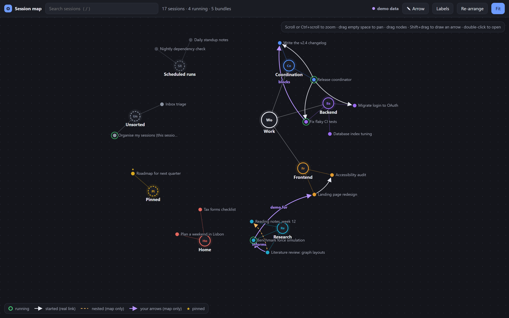
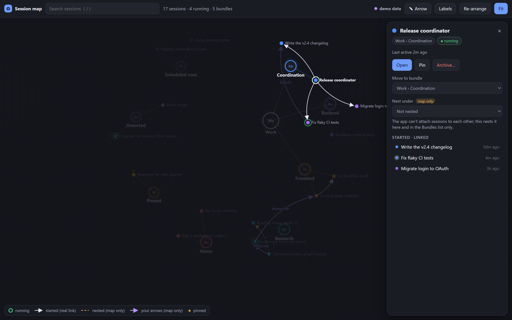
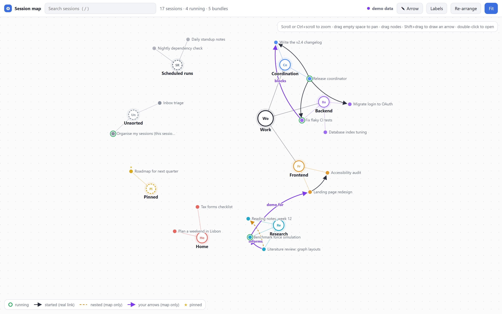

# session-map

See all your coding sessions on one map, and keep them in tidy, nested bundles.



session-map adds two things to the Code tab of the desktop app:

- **A Bundles pane** beside the chat: your sessions grouped into bundles (the sidebar's own sections), with branches, running indicators and one-click actions.
- **An interactive session map**: every session and bundle as a node on a 2D graph you can drag, pan and zoom, with live status and the links between sessions.

## Features

- **Nested bundles.** Name a sidebar section `Parent · Branch` and it shows up as a branch of `Parent`, e.g. `Work · Backend` and `Work · Frontend` under `Work`.
- **Live status.** Running sessions pulse green; pinned sessions get a star; scheduled-task runs are kept apart.
- **Real links.** A white arrow means one session started the other (the app links them: the started session reports back and nests under it in the sidebar).
- **Your own arrows.** Draw arrows between any two nodes and label them ("blocks", "feeds into", ...). They are only drawn on the map and never change a session.
- **Map-only nesting.** Put a session under another one in the map and the Bundles list, for your own overview.
- **One-click actions.** Open, pin, move to a bundle or archive a session from the map or the pane. Archiving asks first and can be undone from the Archived list.
- **Search** (`/`), **fit to screen** (`F`), **re-arrange**, light and dark themes.



## Install

At the prompt of a terminal session:

```
/plugin install session-map --marketplace ktr0a/session-map
```

Answer `y` to add the marketplace, then pick a scope.

From a shell:

```bash
claude plugin install session-map --marketplace ktr0a/session-map
```

In the desktop app: click **+** next to the prompt box, then **Plugins**, **Add marketplace** with `ktr0a/session-map`, then **Add plugin**.

**Requirements:** the Claude Code desktop app (the mod uses the Code tab's sidebar and session tools), and [Node.js](https://nodejs.org) 18 or newer on your `PATH` for the map's small local server.

## Use

| Command | What it does |
| --- | --- |
| `/bundles` | Opens the Bundles pane |
| `/session-map` | Opens the interactive map in your browser |

The Bundles pane also has a **Map ↗** button. `/session-map` prints the map's address too: open it in the app's built-in browser panel to keep the map beside your chat.

### On the map

| Do this | To |
| --- | --- |
| Scroll, or Ctrl + scroll / pinch | Zoom around the pointer |
| Drag empty space | Pan |
| Drag a node | Move it (a bundle brings its sessions along) |
| Click a node | Show its details and actions |
| Double-click a session | Open it |
| Shift + drag from one node to another, or **✎ Arrow** | Draw an arrow |
| Click an arrow | Label, reverse or delete it |
| `/`, `F`, `L`, `Esc` | Search, fit, toggle labels, close the panel |

Where you put things, your arrows and the view are saved, so the map looks the same next time.



### Naming bundles

Bundles are the sidebar's custom sections. Create them from the pane's **New bundle** button (pick a parent to make a branch) or in the sidebar itself. A section named exactly like its parent (`Work` next to `Work · Backend`) shows up as that parent's **General** branch.

## How it works

- The mod reads your sessions and sidebar sections through the app's own tools and refreshes every 15 seconds.
- The map is a single page served by a small Node.js server on `127.0.0.1` only. Its address carries a random key, and the server refuses any request without it, so no other page can read or change your sessions.
- The page asks for changes (move, pin, archive, open); the mod carries them out with the same tools the sidebar uses and reports back.
- Everything stays on your computer, in `~/.claude/session-map` (the page, the server, the key, the latest data and your layout).

## Limits

- The app cannot attach one existing session to another, so map-only nesting and your arrows are for your own overview: they don't link, message or change sessions.
- Scheduled-task runs live under their routine and can't be moved into bundles.
- The map is live while a session with the mod loaded is open.

## Try the demo

Open `web/index.html` in a browser and add `?demo` to the address (for example `file:///.../web/index.html?demo`). It shows made-up sessions, and nothing you do there reaches any session.

## Development

- `hooks/register.tsx`: the mod (pane, commands, data refresh, map bridge).
- `web/index.html`, `web/server.mjs`: the map page and its server. After editing them, run `python web/build-assets.py` to rebuild `hooks/web-assets.ts`, the copy the mod writes out.
- `claude plugin validate .` checks the mod; `claude plugin test .` runs `tests/`.

## License

[MIT](LICENSE)
